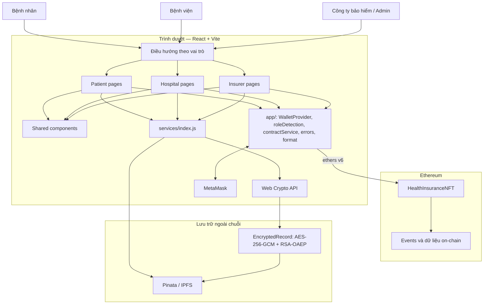

# 3.3. Kiến trúc hệ thống

MediChain được tổ chức theo kiến trúc nhiều lớp, gồm lớp giao diện, lớp điều phối nghiệp vụ phía frontend, lớp smart contract và lớp lưu trữ/mã hóa. Người dùng thao tác thông qua trình duyệt và ví MetaMask. Frontend tiếp nhận thao tác, gọi các service tương ứng và hiển thị kết quả trả về.

## 3.3.1. Sơ đồ kiến trúc tổng thể

**Hình 3.3. Sơ đồ kiến trúc tổng thể của hệ thống MediChain.**

## 3.3.2. Lớp giao diện

Lớp giao diện được xây dựng bằng React và chia theo ba vai trò. Trang Bệnh nhân hỗ trợ quản lý khóa, xem gói bảo hiểm, mua bảo hiểm, xem thẻ NFT, gửi yêu cầu bồi thường và theo dõi hồ sơ. Trang Bệnh viện phục vụ kiểm tra thẻ và xác nhận thông tin điều trị. Trang Công ty bảo hiểm phục vụ quản trị gói, quyền bệnh viện, quỹ và xử lý yêu cầu bồi thường.

Các component dùng chung đảm nhiệm bố cục, trạng thái tải, hiển thị địa chỉ, thông báo lỗi và kết quả giao dịch. Việc chia trang theo vai trò giúp phân tách giao diện và quyền sở hữu mã nguồn của các thành viên.

## 3.3.3. Lớp điều phối frontend

Thư mục frontend/src/app chứa các thành phần điều phối. WalletProvider quản lý trạng thái kết nối ví và mạng. roleDetection xác định vai trò từ quyền đọc được trên contract. contractService là lớp trung gian thực hiện thao tác đọc/ghi blockchain, mô phỏng giao dịch và chuyển lỗi sang thông báo tiếng Việt.

Các trang không gọi smart contract trực tiếp. Chúng sử dụng các hàm đã được contractService cung cấp. ABI và địa chỉ contract được lấy từ các tệp cấu hình sinh tự động, không sửa thủ công.

## 3.3.4. Lớp smart contract

Smart contract HealthInsuranceNFT quản lý gói bảo hiểm, quyền bệnh viện, khóa mã hóa công khai, thẻ bảo hiểm NFT, yêu cầu bồi thường và quỹ chi trả. Những dữ liệu cần kiểm tra tính toàn vẹn và trạng thái nghiệp vụ được ghi trên Ethereum. Các thao tác ghi được kiểm tra quyền và điều kiện theo logic đã thống nhất trong hợp đồng giao tiếp của dự án.

Contract phát ra event khi có các nghiệp vụ như tạo gói, cấp quyền, mua bảo hiểm, gửi yêu cầu, xác nhận, duyệt hoặc từ chối. Frontend có thể truy vấn event để hiển thị lịch sử và tổng hợp thống kê.

## 3.3.5. Lớp lưu trữ và mã hóa

Các tệp như PDF điều khoản, hóa đơn và bản ghi y tế được lưu ngoài chuỗi trên IPFS thông qua Pinata. Blockchain lưu các thông tin tham chiếu cần thiết như CID, thay vì lưu trực tiếp toàn bộ tệp.

Đối với dữ liệu y tế nhạy cảm, nội dung được mã hóa bằng AES-256-GCM. Khóa AES được mã hóa/bọc bằng RSA-OAEP cho từng người nhận được cấp quyền. Cấu trúc EncryptedRecord chứa metadata, phần cipher và keyWraps. Nhờ đó, người dùng cần có khóa riêng tương ứng với địa chỉ ví được ghi trong keyWraps mới có thể mở khóa AES và giải mã nội dung.

## 3.3.6. Luồng tương tác giữa các lớp

1. Người dùng kết nối ví MetaMask và truy cập khu vực theo vai trò.
2. Trang nghiệp vụ gọi contractService để đọc dữ liệu hoặc mô phỏng thao tác ghi.
3. Khi giao dịch hợp lệ, contractService gửi giao dịch qua ethers v6 đến HealthInsuranceNFT.
4. Smart contract kiểm tra điều kiện, cập nhật trạng thái và phát event.
5. Khi cần lưu tệp, trang gọi dịch vụ qua services/index.js; dịch vụ thực hiện mã hóa phù hợp và tải dữ liệu lên IPFS.
6. CID được sử dụng trong dữ liệu nghiệp vụ on-chain; người dùng có quyền có thể tải bản mã và giải mã bằng khóa riêng của mình.

**Phân biệt on-chain và off-chain:** Ethereum lưu trạng thái nghiệp vụ và các tham chiếu cần thiết; IPFS lưu nội dung tệp; trình duyệt thực hiện các thao tác mã hóa/giải mã theo dịch vụ được cung cấp. Không nên mô tả IPFS là nơi tự thực hiện phân quyền giải mã: việc bảo vệ nội dung dựa trên mã hóa và phân phối khóa.

> **Ghi chú hoàn thiện báo cáo:** thay sơ đồ Mermaid bằng ảnh PNG/SVG xuất từ công cụ vẽ nếu định dạng báo cáo Word yêu cầu; rà soát tên các component theo phiên bản mã nguồn cuối cùng trước khi chốt.