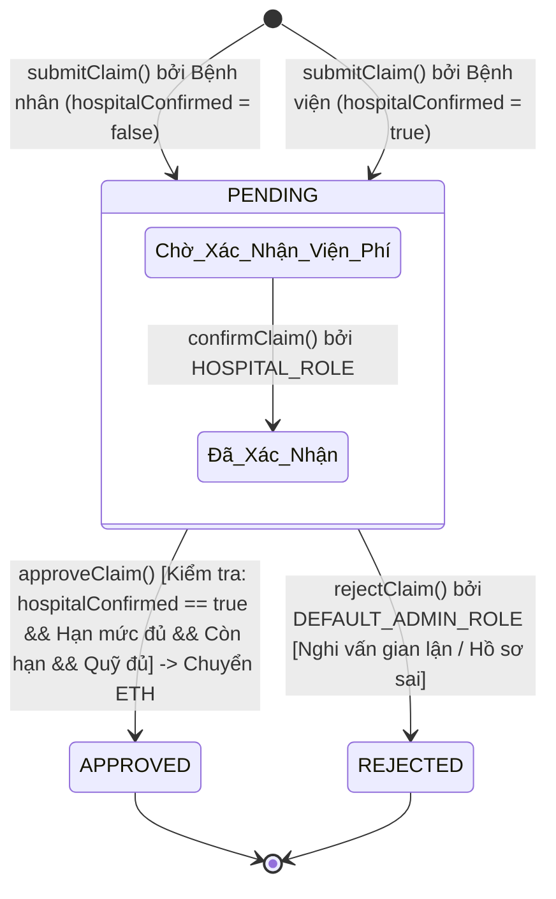

# CHƯƠNG 3. PHÂN TÍCH VÀ THIẾT KẾ HỆ THỐNG (PHẦN THÀNH VIÊN A)

---

## 3.6. Thiết kế chi tiết Smart Contract `HealthInsuranceNFT`

Hợp đồng thông minh `HealthInsuranceNFT` giữ vị trí trung tâm trong kiến trúc vận hành của hệ sinh thái **MediChain**. Hợp đồng được kế thừa từ ba chuẩn module an toàn của OpenZeppelin Contracts v5:
- **`ERC721`:** Quản lý thẻ bảo hiểm y tế dưới dạng tài sản số không thể thay thế (NFT).
- **`AccessControl`:** Quản lý phân quyền dựa trên vai trò (RBAC) với hai quyền hạn cốt lõi: `DEFAULT_ADMIN_ROLE` (Công ty bảo hiểm) và `HOSPITAL_ROLE` (Cơ sở y tế).
- **`ReentrancyGuard`:** Bảo vệ chống lại tấn công tái nhập (Reentrancy) tại các hàm luân chuyển tiền mã hóa (`purchasePolicy`, `approveClaim`).

---

### 3.6.1. Cấu trúc dữ liệu on-chain

Hợp đồng quản lý ba thực thể dữ liệu chính: Gói bảo hiểm mẫu (`Plan`), Thẻ bảo hiểm phát hành cho người bệnh (`Policy`), và Yêu cầu bồi thường viện phí (`Claim`).

#### Bảng 3.6.1: Chi tiết các kiểu dữ liệu và Struct on-chain

| Cấu trúc / Enum | Tên trường (Field) | Kiểu dữ liệu | Ý nghĩa và mục đích lưu trữ |
|---|---|---|---|
| **`Plan`** (Gói bảo hiểm) | `id` | `uint256` | Khóa chính định danh gói bảo hiểm (tự tăng từ 1). |
| | `name` | `string` | Tên gói bảo hiểm (ví dụ: "Gói Cơ Bản", "Gói Nâng Cao"). |
| | `price` | `uint256` | Phí mua bảo hiểm tính bằng wei (ví dụ: `0.002 ETH`). |
| | `coverageLimit` | `uint256` | Hạn mức bồi thường tối đa trong suốt thời hạn gói (wei). |
| | `durationDays` | `uint256` | Thời hạn hiệu lực của gói bảo hiểm tính theo ngày (ví dụ: 30 ngày). |
| | `policyDocCID` | `string` | Định danh nội dung IPFS (CID) của file PDF hợp đồng/điều khoản quy định. |
| | `active` | `bool` | Trạng thái phát hành của gói (`true`: mở bán, `false`: tạm ngừng). |
| **`Policy`** (Thẻ bảo hiểm NFT) | `tokenId` | `uint256` | Khóa chính NFT, định danh thẻ duy nhất (tự tăng từ 1). |
| | `planId` | `uint256` | Mã gói bảo hiểm mẫu mà thẻ được khởi tạo từ đó. |
| | `holder` | `address` | Địa chỉ ví Ethereum của người sở hữu thẻ (bệnh nhân). |
| | `encryptedHealthId` | `string` | Mã số BHYT cá nhân đã được mã hóa RSA bằng khóa công khai của Công ty BH. |
| | `coverageLimit` | `uint256` | Tổng hạn mức chi trả tối đa được thừa hưởng từ Plan. |
| | `usedAmount` | `uint256` | Lũy kế số tiền viện phí đã được giải ngân bồi thường (wei). |
| | `startDate` | `uint256` | Thời điểm bắt đầu hiệu lực (Unix timestamp lúc mua gói). |
| | `expiryDate` | `uint256` | Thời điểm hết hạn của thẻ (Unix timestamp tính theo `durationDays`). |
| | `policyDocCID` | `string` | Bản sao CID điều khoản gói tại thời điểm ký kết hợp đồng. |
| **`ClaimStatus`** (Trạng thái yêu cầu) | `PENDING` | `Enum (0)` | Yêu cầu vừa được khởi tạo, đang chờ xử lý hoặc chờ bệnh viện xác nhận. |
| | `APPROVED` | `Enum (1)` | Yêu cầu đã được kiểm tra điều kiện thành công và tự động giải ngân tiền. |
| | `REJECTED` | `Enum (2)` | Yêu cầu bị Công ty bảo hiểm từ chối do không hợp lệ. |
| **`Claim`** (Hồ sơ bồi thường) | `claimId` | `uint256` | Khóa chính định danh yêu cầu bồi thường (tự tăng từ 1). |
| | `tokenId` | `uint256` | Mã định danh thẻ bảo hiểm NFT được sử dụng để bồi thường. |
| | `patient` | `address` | Địa chỉ ví bệnh nhân thụ hưởng số tiền chi trả. |
| | `hospital` | `address` | Địa chỉ ví cơ sở y tế thực hiện khám chữa và xác nhận chi phí. |
| | `amount` | `uint256` | Số tiền yêu cầu bồi thường ban đầu (wei). |
| | `confirmedAmount` | `uint256` | Số tiền thực tế được bệnh viện xác nhận hợp lệ sau thăm khám. |
| | `hospitalConfirmed` | `bool` | Cờ xác nhận chuyên môn y tế từ bệnh viện (`true`/`false`). |
| | `billCID` | `string` | Định danh IPFS của hình ảnh/hóa đơn viện phí thực tế. |
| | `recordCID` | `string` | Định danh IPFS của tập tin JSON bệnh án đã mã hóa phong bì (AES+RSA). |
| | `status` | `ClaimStatus` | Trạng thái hiện tại của yêu cầu (`PENDING`, `APPROVED`, `REJECTED`). |
| | `createdAt` | `uint256` | Thời điểm nộp yêu cầu bồi thường (Unix timestamp). |
| | `resolvedAt` | `uint256` | Thời điểm kết thúc xử lý duyệt/từ chối (Unix timestamp). |

---

### 3.6.2. Danh mục các hàm nghiệp vụ của hợp đồng thông minh

Hợp đồng `HealthInsuranceNFT` cung cấp 17 hàm nghiệp vụ hoàn chỉnh, đáp ứng toàn diện chu trình sống của bảo hiểm y tế.

#### Bảng 3.6.2: Bảng chi tiết 17 hàm trong hợp đồng HealthInsuranceNFT

| STT | Tên hàm & Chữ ký | Quyền gọi (Access) | Các điều kiện kiểm tra (`require`) | Sự kiện phát ra (`emit`) | Mục đích nghiệp vụ |
|---|---|---|---|---|---|
| 1 | `createPlan(...)` | `DEFAULT_ADMIN_ROLE` | - `price > 0` - `coverageLimit > 0` - `durationDays > 0` | `PlanCreated` | Tạo mới một gói bảo hiểm mẫu kèm điều khoản IPFS. |
| 2 | `setPlanActive(planId, active)` | `DEFAULT_ADMIN_ROLE` | - `planId != 0 && planId <= totalPlans` | `PlanStatusChanged` | Đóng hoặc mở quyền mua đối với một gói bảo hiểm. |
| 3 | `authorizeHospital(hospital, status)` | `DEFAULT_ADMIN_ROLE` | - Không (do OpenZeppelin kiểm tra địa chỉ hợp lệ) | `HospitalAuthorized` | Cấp hoặc thu hồi quyền `HOSPITAL_ROLE` cho cơ sở y tế. |
| 4 | `fundPool()` (`payable`) | Mọi địa chỉ (Public) | - `msg.value > 0` | `PoolFunded` | Nạp thanh khoản ETH vào quỹ bảo hiểm chi trả bồi thường. |
| 5 | `registerEncryptionKey(rsaPublicKeyPem)` | Mọi địa chỉ (Public) | - Không | `EncryptionKeyRegistered` | Đăng ký khóa công khai RSA phục vụ mã hóa phong bì. |
| 6 | `purchasePolicy(planId, encryptedHealthId)` (`payable`) | Người bệnh (Mọi địa chỉ) | - `planId` tồn tại & `plan.active == true` - `msg.value == plan.price` - Không có gói cũ còn hạn: `now > expiryDate` | `PolicyPurchased` | Thu phí ETH, đúc (mint) thẻ bảo hiểm NFT Soulbound cho người bệnh. |
| 7 | `verifyInsurance(patient)` | Xem công khai (`view`) | - Không revert; trả về `(false,0,0,0)` nếu không có thẻ | Không | Kiểm tra tức thì tính hợp lệ, hạn mức còn lại và hạn dùng của thẻ. |
| 8 | `submitClaim(tokenId, amount, billCID, recordCID)` | Bệnh nhân sở hữu thẻ HOẶC Bệnh viện (`HOSPITAL_ROLE`) | - `msg.sender == ownerOf(tokenId) \|\| hasRole(HOSPITAL_ROLE)` - `amount > 0` - `now <= expiryDate` - `amount <= coverageLimit - usedAmount` | `ClaimSubmitted` | Khởi tạo hồ sơ bồi thường viện phí, lưu trữ CID hóa đơn và bệnh án mã hóa. |
| 9 | `confirmClaim(claimId, confirmedAmount)` | Cơ sở y tế (`HOSPITAL_ROLE`) | - `claimId` tồn tại - `status == PENDING` - `confirmedAmount > 0` - `confirmedAmount <= amount` | `ClaimConfirmed` | **(RÀNG BUỘC 1)** Bệnh viện xác nhận chi phí khám chữa bệnh thực tế. |
| 10 | `approveClaim(claimId)` | Mọi địa chỉ (Tự động chi trả) | - `claimId` tồn tại - `status == PENDING` - `hospitalConfirmed == true` - `now <= expiryDate` - `usedAmount + amt <= coverageLimit` - `balance >= amt` | `ClaimApproved` | **(RÀNG BUỘC 2)** Kiểm tra toàn diện điều kiện và tự động chuyển ETH bồi thường. |
| 11 | `rejectClaim(claimId, reason)` | `DEFAULT_ADMIN_ROLE` | - `claimId` tồn tại - `status == PENDING` | `ClaimRejected` | Từ chối yêu cầu bồi thường nếu phát hiện gian lận hoặc sai sót. |
| 12 | `getPlans()` | Xem công khai (`view`) | - Không | Không | Lấy toàn bộ danh sách gói bảo hiểm để hiển thị trên giao diện. |
| 13 | `getPolicy(tokenId)` | Xem công khai (`view`) | - Không | Không | Truy vấn chi tiết thông tin hạn mức, thời hạn của một thẻ bảo hiểm. |
| 14 | `getClaim(claimId)` | Xem công khai (`view`) | - `claimId != 0 && claimId <= totalClaims` | Không | Truy vấn toàn bộ dữ liệu chi tiết của một yêu cầu bồi thường. |
| 15 | `getClaimsByPatient(patient)` | Xem công khai (`view`) | - Không | Không | Lấy danh sách toàn bộ mã `claimId` thuộc sở hữu của một bệnh nhân. |
| 16 | `poolBalance()` | Xem công khai (`view`) | - Không | Không | Truy vấn số dư ETH hiện có trong quỹ chi trả bồi thường. |
| 17 | `tokenURI(tokenId)` | Xem công khai (`view`) | - Thẻ phải tồn tại (`_requireOwned`) | Không | Trả về đường dẫn siêu dữ liệu `ipfs://<policyDocCID>` của thẻ NFT. |

---

### 3.6.3. Sơ đồ máy trạng thái yêu cầu bồi thường (Claim State Machine)

Chu trình xử lý một yêu cầu bồi thường viện phí trong MediChain tuân thủ nghiêm ngặt máy trạng thái hữu hạn (Finite State Machine). Một yêu cầu chỉ có thể di chuyển một chiều từ trạng thái khởi tạo `PENDING` sang trạng thái kết thúc `APPROVED` hoặc `REJECTED`, ngăn chặn hoàn toàn nguy cơ xử lý trùng lặp hoặc gian lận chi trả hai lần.

#### Phân tích các bước chuyển trạng thái:
1. **Khởi tạo (`submitClaim`):**
   - **Trường hợp 1 (Bệnh viện nộp thay):** Bệnh viện trực tiếp gửi yêu cầu điều trị kèm hóa đơn; `hospitalConfirmed` được tự động gán bằng `true`, `confirmedAmount = amount`. Yêu cầu sẵn sàng được kiểm tra chi trả.
   - **Trường hợp 2 (Bệnh nhân tự nộp):** Bệnh nhân nộp hóa đơn sau khi ra viện; cờ `hospitalConfirmed` được đặt là `false`. Yêu cầu rơi vào trạng thái chờ bệnh viện kiểm tra đối soát.
2. **Xác nhận chuyên môn (`confirmClaim`):**
   - Chỉ địa chỉ ví sở hữu quyền `HOSPITAL_ROLE` mới có thể gọi hàm này. Bệnh viện rà soát hồ sơ, xác nhận mức chi phí thực tế được bảo hiểm chấp nhận (`confirmedAmount <= amount`) và kích hoạt cờ `hospitalConfirmed = true`.
3. **Phê duyệt và Chi trả tự động (`approveClaim`):**
   - Kiểm tra điều kiện tiên quyết: yêu cầu phải ở trạng thái `PENDING` và đã có xác nhận của bệnh viện (`c.hospitalConfirmed == true`).
   - Kiểm tra các tham số hạn mức: `usedAmount + amt <= coverageLimit` và `block.timestamp <= expiryDate`.
   - Kiểm tra quỹ chi trả: `address(this).balance >= amt`.
   - Khi toàn bộ điều kiện thỏa mãn, trạng thái chuyển sang `APPROVED`, cập nhật `usedAmount` và chuyển tiền ETH tức thì về ví người bệnh.
4. **Từ chối chi trả (`rejectClaim`):**
   - Chỉ quản trị viên bảo hiểm (`DEFAULT_ADMIN_ROLE`) có thẩm quyền chuyển trạng thái sang `REJECTED` kèm lý do cụ thể nếu hồ sơ bệnh án không hợp lệ hoặc có dấu hiệu trục lợi.

---

### 3.6.4. Danh mục các sự kiện on-chain (Events)

Các sự kiện (events) được phát ra (emit) từ smart contract đóng vai trò cốt lõi trong việc giao tiếp giữa blockchain và hệ thống bên ngoài: giúp frontend cập nhật giao diện theo thời gian thực và cho phép các dịch vụ giám sát (như Etherscan hoặc script Web3.py) lập chỉ mục (indexing) lịch sử giao dịch.

#### Bảng 3.6.4: Chi tiết 10 sự kiện trong hợp đồng HealthInsuranceNFT

| STT | Tên sự kiện (Event) | Các tham số có đánh chỉ mục (`indexed`) | Các tham số không đánh chỉ mục | Mục đích ghi nhận và giám sát |
|---|---|---|---|---|
| 1 | `PlanCreated` | `uint256 indexed planId` | `string name`, `uint256 price`, `uint256 coverageLimit`, `uint256 durationDays`, `string policyDocCID` | Ghi nhận gói bảo hiểm mới được tạo trên hệ thống. |
| 2 | `PlanStatusChanged` | `uint256 indexed planId` | `bool active` | Lắng nghe thay đổi trạng thái kích hoạt/tạm dừng của gói. |
| 3 | `HospitalAuthorized` | `address indexed hospital` | `bool status` | Theo dõi việc cấp hoặc thu hồi quyền khám chữa bệnh của bệnh viện. |
| 4 | `PoolFunded` | `address indexed from` | `uint256 amount` | Ghi nhận dòng tiền nạp vào quỹ bảo hiểm chi trả. |
| 5 | `EncryptionKeyRegistered` | `address indexed user` | Không | Lắng nghe địa chỉ ví vừa cập nhật khóa công khai RSA lên hệ thống. |
| 6 | `PolicyPurchased` | `uint256 indexed tokenId`, `address indexed holder` | `uint256 planId`, `uint256 expiryDate` | Theo dõi việc phát hành thẻ NFT bảo hiểm mới cho người bệnh. |
| 7 | `ClaimSubmitted` | `uint256 indexed claimId`, `uint256 indexed tokenId`, `address indexed patient` | `address submittedBy`, `uint256 amount` | Lập chỉ mục yêu cầu bồi thường mới, phân loại người nộp hồ sơ. |
| 8 | `ClaimConfirmed` | `uint256 indexed claimId`, `address indexed hospital` | `uint256 confirmedAmount` | Ghi nhận bằng chứng xác thực viện phí từ cơ sở y tế. |
| 9 | `ClaimApproved` | `uint256 indexed claimId`, `address indexed patient` | `uint256 amount` | Bằng chứng on-chain xác nhận giao dịch giải ngân bồi thường thành công. |
| 10 | `ClaimRejected` | `uint256 indexed claimId` | `string reason` | Lưu vết lý do từ chối bồi thường minh bạch trên sổ cái blockchain. |
