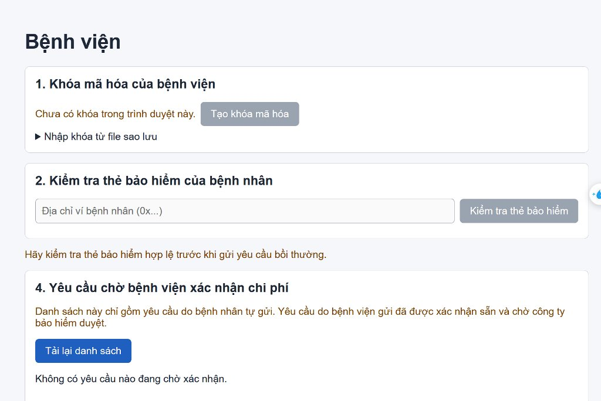

# CHƯƠNG 4. HIỆN THỰC HỆ THỐNG (PHẦN THÀNH VIÊN A)

---

## 4.5. Hiện thực giao diện DApp — Phân hệ Bệnh viện (`/hospital`)

Phân hệ Bệnh viện được xây dựng bằng React kết hợp cùng `ethers.js` v6, giao tiếp trực tiếp với ví điện tử MetaMask và smart contract `HealthInsuranceNFT`. Giao diện được thiết kế theo phong cách hiện đại (Modern Clean CSS3), tối ưu hóa trải nghiệm người dùng y tế với độ tương phản cao, cỡ chữ đạt chuẩn từ 16px trở lên, và bố cục chia thành 4 khối chức năng nghiệp vụ rõ ràng.

---

### 4.5.1. Kiến trúc thành phần của Phân hệ Bệnh viện

Màn hình Bệnh viện (`HospitalPage.jsx`) được tổ chức theo kiến trúc hướng module với 4 khối thành phần độc lập:

```text
┌─────────────────────────────────────────────────────────────┐
│                   GIAO DIỆN BỆNH VIỆN                       │
│                                                             │
│  [ Khối 1: Quản lý khóa mã hóa RSA (KeySetup.jsx) ]         │
│  - Sinh cặp khóa RSA-OAEP 2048, lưu Private Key an toàn     │
│  - Đăng ký Public Key lên on-chain (registerEncryptionKey)  │
│  - Sao lưu / Nhập khóa từ file JSON                         │
│                                                             │
│  [ Khối 2: Tra cứu & Kiểm tra thẻ bảo hiểm (VerifyCard.jsx) ]│
│  - Nhập địa chỉ ví bệnh nhân (0x...)                        │
│  - Gọi verifyInsurance() kiểm tra tính hợp lệ tức thì       │
│  - Hiển thị TokenId, hạn mức khả dụng (ETH), ngày hết hạn   │
│                                                             │
│  [ Khối 3: Lập hồ sơ bồi thường viện phí (SubmitClaimForm) ]│
│  - Chỉ hiển thị khi Khối 2 đã xác minh thẻ hợp lệ           │
│  - Nhập chi phí viện phí (ETH), lý do thăm khám             │
│  - Tải lên ảnh/PDF hóa đơn viện phí lên IPFS (Pinata)       │
│  - Mã hóa hồ sơ bệnh án bằng AES-GCM + bọc khóa RSA         │
│  - Gửi giao dịch submitClaim() (tự động confirmed = true)   │
│                                                             │
│  [ Khối 4: Đối soát & Xác nhận chi phí (PendingConfirmList) ]│
│  - Lắng nghe sự kiện ClaimSubmitted lọc yêu cầu chờ duyệt   │
│  - Xem chi tiết hóa đơn và bệnh án giải mã                  │
│  - Nhập số tiền viện phí thực tế hợp lệ                     │
│  - Gửi giao dịch confirmClaim() (Ràng buộc 1)               │
└─────────────────────────────────────────────────────────────┘
```

---

### 4.5.2. Chi tiết 4 khối chức năng nghiệp vụ

#### 1. Khối Quản lý khóa mã hóa y tế (`KeySetup.jsx`)
- **Nghiệp vụ:** Bệnh viện cần cặp khóa bất đối xứng RSA-OAEP 2048 để tham gia vào cơ chế mã hóa phong bì (Envelope Encryption).
- **Thực thi:**
  - Nút **"Tạo khóa mã hóa"** gọi WebCrypto API tạo cặp khóa. Khóa riêng (Private Key) được lưu an toàn trong `localStorage` của trình duyệt.
  - Sau khi sinh khóa, hệ thống tự động gọi hàm `registerEncryptionKey(publicKeyPem)` gửi giao dịch lưu khóa công khai lên smart contract, phát ra event `EncryptionKeyRegistered`.
  - Cung cấp tính năng **Xuất khóa sao lưu** (tải file `.json`) và **Nhập khóa** giúp bác sĩ khôi phục phiên làm việc khi đổi máy tính.

#### 2. Khối Tra cứu và Kiểm tra thẻ bảo hiểm NFT (`VerifyCard.jsx`)
- **Nghiệp vụ:** Khi bệnh nhân nhập viện, điều dưỡng/bác sĩ nhập địa chỉ ví của bệnh nhân để kiểm tra quyền lợi bảo hiểm trước khi tiến hành điều trị.
- **Thực thi:**
  - Nhập địa chỉ ví bệnh nhân (ví dụ: `0xa4FE...`).
  - Giao diện gọi hàm `verifyInsurance(patient)` trên smart contract dưới dạng truy vấn không tốn gas (`view call`).
  - Hợp đồng trả về 4 giá trị: `isValid` (tính hiệu lực), `tokenId` (mã thẻ NFT), `remainingLimit` (hạn mức bồi thường còn lại quy đổi ra ETH), và `expiryDate` (thời điểm hết hạn).
  - Nếu hợp lệ, hệ thống hiển thị thẻ thông tin màu xanh lá và chuyển tiếp dữ liệu xác thực sang Khối 3.

#### 3. Khối Lập hồ sơ bồi thường viện phí (`SubmitClaimForm.jsx`)
- **Nghiệp vụ:** Bệnh viện nộp hồ sơ bồi thường trực tiếp cho bệnh nhân đã được xác minh thẻ hợp lệ.
- **Thực thi:**
  - Khối này áp dụng cơ chế bảo vệ giao diện: chỉ xuất hiện khi Khối 2 đã xác thực thành công.
  - Người dùng tải tệp hóa đơn viện phí (ảnh PNG/JPG hoặc PDF), hệ thống tải lên IPFS qua Pinata để lấy `billCID`.
  - Bác sĩ nhập chẩn đoán lâm sàng và phác đồ điều trị. Hệ thống tự động sinh khóa AES-256-GCM, mã hóa toàn bộ dữ liệu y tế, bọc khóa AES bằng khóa công khai RSA của 3 bên (Bệnh nhân, Bệnh viện, Công ty bảo hiểm) và tải tập tin JSON bệnh án lên IPFS lấy `recordCID`.
  - Giao diện gọi hàm `submitClaim(tokenId, amount, billCID, recordCID)`. Do người gọi là ví có `HOSPITAL_ROLE`, smart contract tự động gán `c.hospitalConfirmed = true` và `c.confirmedAmount = amount`.

#### 4. Khối Đối soát và Xác nhận chi phí viện phí (`PendingConfirmList.jsx`)
- **Nghiệp vụ:** Dành riêng để xử lý các hồ sơ do bệnh nhân tự nộp sau khi ra viện.
- **Thực thi:**
  - Hệ thống truy vấn các sự kiện `ClaimSubmitted` on-chain để lọc danh sách các yêu cầu có `hospitalConfirmed == false` và trạng thái `PENDING`.
  - Bệnh viện kiểm tra hóa đơn và số tiền bệnh nhân yêu cầu.
  - Bác sĩ nhập số tiền viện phí thực tế được chấp nhận (bắt buộc `confirmedAmount <= amount`) và bấm nút **"Xác nhận chi phí"**.
  - Giao diện kích hoạt MetaMask để ký giao dịch gọi hàm `confirmClaim(claimId, confirmedAmount)` thực hiện Ràng buộc logic 1.

---

### 4.5.3. Minh chứng hình ảnh giao diện phân hệ Bệnh viện

Dưới đây là hình ảnh thực tế của Phân hệ Bệnh viện khi kết nối với mạng Sepolia Testnet thông qua ví MetaMask:


*Hình 4.5.1: Màn hình nghiệp vụ Bệnh viện với Khối quản lý khóa mã hóa, Khối tra cứu thẻ bảo hiểm và Danh sách hồ sơ chờ xác nhận chi phí.*

- **Đánh giá hình ảnh:** Giao diện hiển thị rõ ràng thông báo hướng dẫn, trường nhập địa chỉ ví bệnh nhân, nút thao tác trực quan và thông báo trạng thái xử lý giao dịch.
