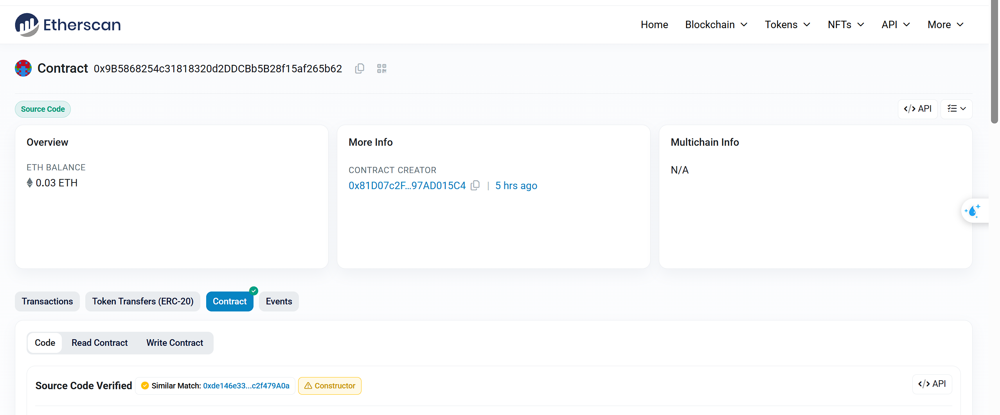
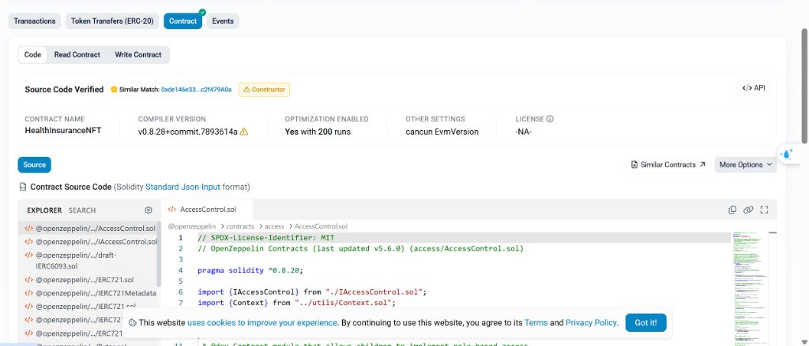

# CHƯƠNG 4. HIỆN THỰC HỆ THỐNG (PHẦN THÀNH VIÊN A)

---

## 4.6. Triển khai thực tế trên mạng thử nghiệm Ethereum Sepolia Testnet

Để đáp ứng trọn vẹn yêu cầu Tiêu chí 1 của Rubric đánh giá đồ án, hợp đồng thông minh `HealthInsuranceNFT` đã được biên dịch, tối ưu hóa và triển khai thành công trên mạng thử nghiệm công khai **Ethereum Sepolia Testnet** (Chain ID: `11155111`). Mã nguồn hợp đồng đã được xác thực công khai (Source Code Verified) trên trình khám phá khối Etherscan.

---

### 4.6.1. Thông số kỹ thuật triển khai

Hợp đồng được triển khai thông qua script tự động `scripts/deploy.js` kết hợp với dịch vụ RPC của Alchemy và khóa bí mật của ví triển khai. Toàn bộ các thông số kỹ thuật được ghi nhận chính thức như sau:

#### Bảng 4.6.1: Bảng thông số triển khai hợp đồng HealthInsuranceNFT trên Sepolia

| Thuộc tính triển khai | Giá trị thực tế trên Ethereum Sepolia |
|---|---|
| **Tên Smart Contract** | `HealthInsuranceNFT` |
| **Ký hiệu Token (Symbol)** | `HIC` (Health Insurance Card) |
| **Địa chỉ Hợp đồng (Contract Address)** | `0x9B5868254c31818320d2DDCBb5B28f15af265b62` |
| **Khối triển khai (Deployment Block)** | Block số `12103715` |
| **Địa chỉ ví Deployer (Admin)** | `0x81D07c2F8F49F7B91bF245Fe9fA8fa0a97AD015C4` |
| **Địa chỉ ví Bệnh viện được cấp quyền** | `0xb381e33456e08F79cdeA9722506dabbdF2933F12` |
| **Số dư Quỹ bảo hiểm ban đầu** | `0.03 ETH` |
| **Phiên bản trình biên dịch (Compiler)** | Solidity `v0.8.28+commit.7893614a` |
| **Cấu hình tối ưu hóa (Optimizer)** | Kích hoạt (Enabled) với 200 runs |
| **Phiên bản EVM (EVM Version)** | `cancun` |
| **Trạng thái Etherscan** | **Source Code Verified (Dấu tích xanh)** |
| **Đường dẫn tra cứu Etherscan** | [Xem trên Sepolia Etherscan](https://sepolia.etherscan.io/address/0x9B5868254c31818320d2DDCBb5B28f15af265b62#code) |

---

### 4.6.2. Quy trình khởi tạo dữ liệu mẫu (Seed Script)

Sau khi hợp đồng được triển khai, nhóm thực hiện chạy script khởi tạo `scripts/seed.js` để thiết lập môi trường sẵn sàng phục vụ kiểm thử và demo:
1. **Cấp quyền cho Bệnh viện:** Gọi `authorizeHospital("0xb381e33456e08F79cdeA9722506dabbdF2933F12", true)` để gán vai trò `HOSPITAL_ROLE`.
2. **Nạp quỹ bảo hiểm:** Gọi `fundPool()` với số tiền `0.03 ETH` nhằm đảm bảo tính thanh khoản cho các giao dịch chi trả bồi thường tự động.
3. **Tạo 2 gói bảo hiểm mẫu:**
   - *Gói 1: Gói Cơ Bản:* Giá phí `0.002 ETH`, hạn mức bồi thường `0.05 ETH`, thời hạn 30 ngày, liên kết tài liệu điều khoản IPFS CID `QmZ8rC1wGk...`.
   - *Gói 2: Gói Nâng Cao:* Giá phí `0.005 ETH`, hạn mức bồi thường `0.15 ETH`, thời hạn 90 ngày.

---

### 4.6.3. Minh chứng xác thực trên Sepolia Etherscan

Dưới đây là các hình ảnh chụp thực tế từ trình khám phá khối Etherscan xác minh hợp đồng đã được triển khai và xác thực mã nguồn thành công:

*Hình 4.6.1: Minh chứng hợp đồng HealthInsuranceNFT đã được xác thực mã nguồn (Source Code Verified) với dấu tích xanh trên Sepolia Etherscan.*

*Hình 4.6.2: Tổng quan hợp đồng trên Sepolia Etherscan hiển thị số dư quỹ 0.03 ETH và thông tin ví tạo lập.*

Việc xác thực mã nguồn công khai trên Etherscan cho phép giảng viên, hội đồng chấm thi và người dùng độc lập có thể trực tiếp kiểm tra mã nguồn, đọc trạng thái hợp đồng (tab *Read Contract*) và thực thi các giao dịch thử nghiệm (tab *Write Contract*) một cách hoàn toàn minh bạch.
