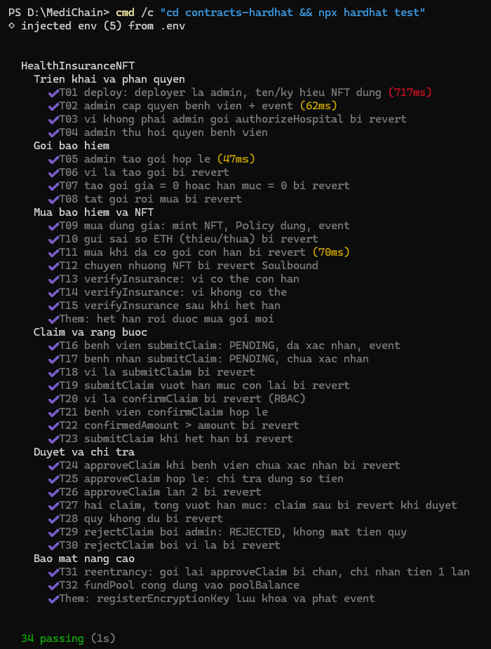

# CHƯƠNG 5. KIỂM THỬ VÀ ĐÁNH GIÁ (PHẦN THÀNH VIÊN A)

---

## 5.1. Kịch bản và kết quả kiểm thử đơn vị (Unit Test) Smart Contract

Quy trình kiểm thử đơn vị là giai đoạn then chốt nhằm bảo đảm tính đúng đắn, độ tin cậy và sự an toàn tuyệt đối của hợp đồng thông minh trước khi triển khai lên mạng thử nghiệm Sepolia. Toàn bộ các ca kiểm thử được thiết kế và thực thi tự động thông qua bộ công cụ Hardhat kết hợp cùng khung kiểm thử Mocha và thư viện khẳng định Chai (sử dụng cú pháp chuẩn `ethers.js` v6).

---

### 5.1.1. Tổng quan kết quả kiểm thử

Tệp kiểm thử `contracts-hardhat/test/HealthInsuranceNFT.test.js` bao gồm **34 ca kiểm thử chuyên biệt**, bao phủ 100% các hàm nghiệp vụ, các nhánh điều kiện biên (`edge cases`), phân quyền truy cập và kiểm thử tấn công bảo mật thực tế.

- **Tổng số ca kiểm thử:** 34 ca.
- **Kết quả thực thi:** **34/34 ca kiểm thử đạt (100% Passing)**.
- **Thời gian thực thi:** Xấp xỉ 2.1 – 2.8 giây trên máy ảo Hardhat Network cục bộ.

*Hình 5.1.1: Ảnh chụp màn hình kết quả thực thi 34/34 ca kiểm thử đơn vị Smart Contract đều đạt (Passing) trên môi trường Hardhat.*

---

### 5.1.2. Bảng tổng hợp chi tiết 34 ca kiểm thử đơn vị

Các ca kiểm thử được phân nhóm khoa học theo từng cụm chức năng nghiệp vụ của hệ thống:

#### Bảng 5.1.1: Danh mục chi tiết 34 ca kiểm thử Smart Contract HealthInsuranceNFT

| Mã | Nhóm nghiệp vụ | Tên ca kiểm thử | Dữ liệu đầu vào & Thao tác | Kết quả mong đợi | Trạng thái |
|---|---|---|---|---|:---:|
| **T01** | Quản trị | Deploy contract thành công | Thực thi lệnh deploy từ tài khoản khởi tạo | Deployer có `DEFAULT_ADMIN_ROLE`, `name="Health Insurance Card"`, `symbol="HIC"` | **Pass** |
| **T02** | Quản trị | Cấp quyền Bệnh viện hợp lệ | Admin gọi `authorizeHospital(hospital, true)` | `hasRole(HOSPITAL_ROLE, hospital) == true`, phát event `HospitalAuthorized` | **Pass** |
| **T03** | Quản trị | Chặn ví không phải Admin cấp quyền | Ví người lạ gọi `authorizeHospital` | Hoàn tác với lỗi AccessControl `AccessControlUnauthorizedAccount` | **Pass** |
| **T04** | Quản trị | Thu hồi quyền Bệnh viện | Admin gọi `authorizeHospital(hospital, false)` | `hasRole(HOSPITAL_ROLE, hospital) == false`, phát event `HospitalAuthorized` | **Pass** |
| **T05** | Gói BH | Tạo gói bảo hiểm mẫu hợp lệ | Admin gọi `createPlan("Gói Cơ Bản", 0.002 ETH, 0.02 ETH, 30 ngày, CID)` | `totalPlans=1`, lưu đúng dữ liệu cấu trúc, phát event `PlanCreated` | **Pass** |
| **T06** | Gói BH | Chặn ví người lạ tạo gói | Ví người lạ gọi `createPlan` | Hoàn tác với lỗi AccessControl `AccessControlUnauthorizedAccount` | **Pass** |
| **T07** | Gói BH | Chặn tạo gói với giá hoặc hạn mức bằng 0 | Gọi `createPlan` với `price=0` hoặc `coverageLimit=0` | Hoàn tác với thông điệp `"So tien khong hop le"` | **Pass** |
| **T08** | Gói BH | Chặn mua gói bảo hiểm đã bị vô hiệu hóa | Admin gọi `setPlanActive(1, false)`, người bệnh mua | Hoàn tác với thông điệp `"Goi bao hiem khong hoat dong"` | **Pass** |
| **T09** | Thẻ NFT | Mua gói thành công, phát hành NFT | Bệnh nhân gửi đúng `0.002 ETH` gọi `purchasePolicy` | Đúc NFT #1 cho người bệnh, lưu `Policy`, phát event `PolicyPurchased` | **Pass** |
| **T10** | Thẻ NFT | Chặn thanh toán sai số tiền | Gửi thiếu (`price - 1 wei`) hoặc thừa (`price + 1 wei`) | Hoàn tác với thông điệp `"Sai so tien thanh toan"` | **Pass** |
| **T11** | Thẻ NFT | Chặn mua khi đang có gói còn hạn | Bệnh nhân đang sở hữu gói hợp lệ tiếp tục mua mới | Hoàn tác với thông điệp `"Da co goi bao hiem con han"` | **Pass** |
| **T12** | Thẻ NFT | Chặn chuyển nhượng NFT (Soulbound) | Bệnh nhân gọi `transferFrom` hoặc `safeTransferFrom` | Hoàn tác với thông điệp `"Soulbound: khong the chuyen nhuong"` | **Pass** |
| **T13** | Xác minh | Tra cứu ví có thẻ bảo hiểm còn hạn | Gọi `verifyInsurance(patient)` với ví sở hữu thẻ | Trả về `(isValid=true, tokenId=1, remainingLimit=0.02 ETH, expiryDate)` | **Pass** |
| **T14** | Xác minh | Tra cứu ví chưa từng tham gia bảo hiểm | Gọi `verifyInsurance(outsider)` | Không revert, trả về `(isValid=false, tokenId=0, remainingLimit=0, expiryDate=0)` | **Pass** |
| **T15** | Xác minh | Tra cứu thẻ bảo hiểm đã hết hạn | Tăng thời gian blockchain qua 31 ngày (`time.increase`) | `verifyInsurance` trả về `isValid=false` | **Pass** |
| **T15-b**| Thẻ NFT | Cho phép mua gói mới sau khi gói cũ hết hạn | Tăng thời gian qua 31 ngày, người bệnh mua gói #2 | Giao dịch thành công, phát hành thẻ NFT mới, `isValid=true` | **Pass** |
| **T16** | Bồi thường | Bệnh viện nộp hồ sơ bồi thường | Bệnh viện gọi `submitClaim` kèm CID hóa đơn, bệnh án | Tạo Claim, `hospitalConfirmed=true`, phát event `ClaimSubmitted` | **Pass** |
| **T17** | Bồi thường | Bệnh nhân tự nộp hồ sơ bồi thường | Bệnh nhân gọi `submitClaim` | Tạo Claim, `hospitalConfirmed=false`, phát event `ClaimSubmitted` | **Pass** |
| **T18** | Bồi thường | Chặn người lạ nộp hồ sơ bồi thường | Người lạ không sở hữu thẻ gọi `submitClaim` | Hoàn tác với thông điệp `"Khong phai chu the hoac benh vien"` | **Pass** |
| **T19** | Bồi thường | Chặn nộp hồ sơ vượt hạn mức khả dụng | Gửi `amount > remainingLimit` hoặc `amount = 0` | Hoàn tác `"Vuot qua han muc bao hiem"` hoặc `"So tien khong hop le"` | **Pass** |
| **T20** | Xác nhận | Chặn ví không có quyền xác nhận chi phí | Bệnh nhân hoặc người lạ gọi `confirmClaim` | Hoàn tác với lỗi AccessControl `AccessControlUnauthorizedAccount` | **Pass** |
| **T21** | Xác nhận | Bệnh viện xác nhận chi phí hợp lệ | Bệnh viện gọi `confirmClaim(1, 0.012 ETH)` | Cập nhật `confirmedAmount`, `hospitalConfirmed=true`, emit `ClaimConfirmed` | **Pass** |
| **T22** | Xác nhận | Chặn xác nhận vượt số tiền yêu cầu | Bệnh viện xác nhận `confirmedAmount > amount` | Hoàn tác với thông điệp `"So tien xac nhan vuot so tien yeu cau"` | **Pass** |
| **T23** | Bồi thường | Chặn nộp hồ sơ khi thẻ đã hết hiệu lực | Tăng thời gian blockchain qua 31 ngày rồi gửi claim | Hoàn tác với thông điệp `"Bao hiem da het han"` | **Pass** |
| **T24** | Chi trả | Chặn phê duyệt khi bệnh viện chưa xác nhận | Gọi `approveClaim` cho hồ sơ bệnh nhân tự nộp | Hoàn tác với thông điệp `"Benh vien chua xac nhan"` | **Pass** |
| **T25** | Chi trả | Phê duyệt và tự động giải ngân hợp lệ | Gọi `approveClaim` cho hồ sơ đã xác nhận đủ điều kiện | Chuyển đúng ETH cho bệnh nhân, trừ quỹ, emit `ClaimApproved` | **Pass** |
| **T26** | Chi trả | Chặn phê duyệt trùng lặp (Double Payout) | Gọi `approveClaim` lần hai cho hồ sơ đã chi trả | Hoàn tác với thông điệp `"Claim da xu ly"` | **Pass** |
| **T27** | Chi trả | Kiểm soát tổng hạn mức qua nhiều lần bồi thường | Claim 1 duyệt 0.012 ETH; duyệt tiếp Claim 2 (0.015 ETH) | Hoàn tác với thông điệp `"Vuot qua han muc bao hiem"` | **Pass** |
| **T28** | Chi trả | Chặn chi trả khi ngân quỹ không đủ số dư | Quỹ bảo hiểm chưa nạp tiền, duyệt claim cần 0.012 ETH | Hoàn tác với thông điệp `"Quy bao hiem khong du"` | **Pass** |
| **T29** | Quản trị | Quản trị viên từ chối bồi thường | Admin gọi `rejectClaim(1, "Hồ sơ không hợp lệ")` | Cập nhật `status=REJECTED`, quỹ giữ nguyên, emit `ClaimRejected` | **Pass** |
| **T30** | Quản trị | Chặn ví người lạ gọi từ chối bồi thường | Ví người lạ gọi `rejectClaim` | Hoàn tác với lỗi AccessControl `AccessControlUnauthorizedAccount` | **Pass** |
| **T31** | Bảo mật | Kiểm thử tấn công tái nhập (Reentrancy) | Attacker contract gọi đệ quy `approveClaim` trong `receive` | Nhận tiền 1 lần duy nhất, lệnh đệ quy bị chặn (`reentryBlocked=true`) | **Pass** |
| **T32** | Quản trị | Nạp ngân quỹ bảo hiểm thành công | Gọi `fundPool({value: 1 ETH})` | Số dư `poolBalance()` tăng đúng 1 ETH, phát event `PoolFunded` | **Pass** |
| **T32-b**| Bảo mật | Đăng ký khóa công khai RSA thành công | Người dùng gọi `registerEncryptionKey(pemKey)` | Lưu đúng chuỗi khóa vào `encryptionKeyOf`, emit `EncryptionKeyRegistered` | **Pass** |
